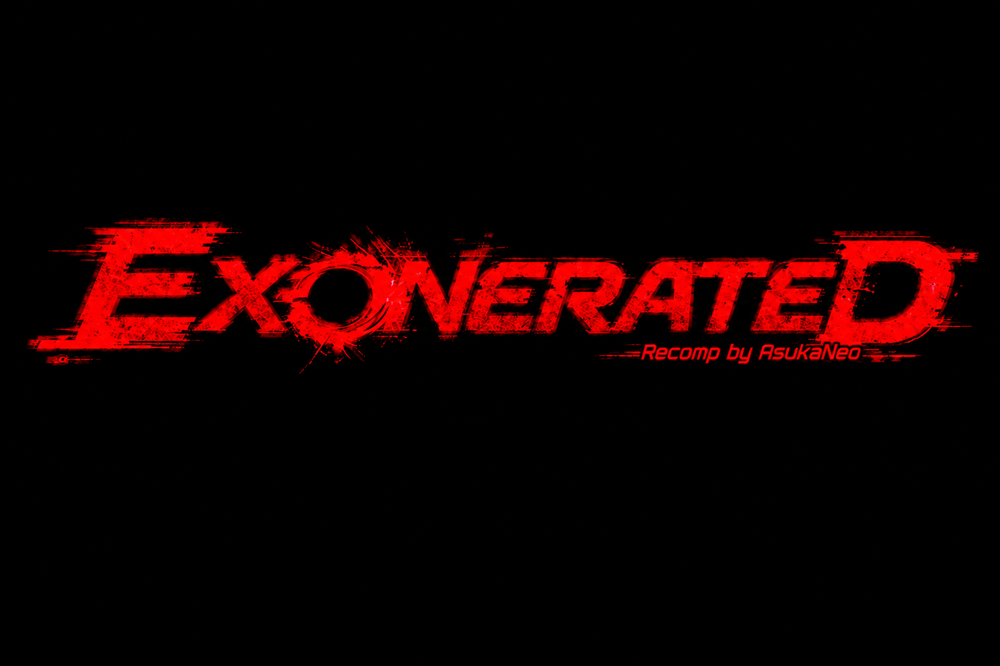

  

  <b>A recompilation of <i>Deathrow</i> for the original Xbox, running natively on Windows.</b>

  
  
  
  

> [!WARNING]
> **Pre-alpha.** Full matches play from start to finish, but there is no download yet: you build it from your own copy of the game. The first public download, a beta, comes with the GPU renderer.

## About

*Deathrow* (2002) never left the original Xbox, and its developer is long gone. **Exonerated** turns the game's code into C and compiles it for a modern PC, so it runs natively, without an emulator, with modern conveniences on top. Bring your own copy: nothing from the game is included here.

## Status

- ✅ Full matches, menus, audio, controller with rumble, keyboard
- ✅ GPU renderer (Direct3D 11) at up to 4x the Xbox's resolution, in the game's own 16:9 mode
- ✅ The game's movies, in the game window: the intros, the attract loop, the clip in the game-mode menu
- ✅ Scalable window, borderless fullscreen, in-game settings overlay
- 🚧 Game speed: paced at 30 frames per second for now (the game ran too fast at 60)
- 🚧 Some texture glitches, including a striped backdrop on the pre-match loading screen
- ⛔ No online or System Link play, and none planned

## What you need

- *Deathrow* for the original Xbox, **North American release** (version 3), as a disc image (`.iso`) or its files (`default.xbe` and the `data` folder)
- Windows 10 or 11, 64-bit, and a graphics card with Direct3D 11

## Download and play

*From the beta onward, once releases are published:*

1. Download the latest `Exonerated-…-windows-x64.zip` from [Releases](https://github.com/AsukaNeo/Exonerated/releases) and unzip it anywhere.
2. Double-click **`Exonerated.exe`** and choose your Deathrow disc image (`.iso`), or the `default.xbe` from its files. Exonerated checks it's the supported release and copies the game, movies included, into a `game` folder next to itself, once.
3. Play.

## Build it yourself

You also need some free tools, installed once: [Build Tools for Visual Studio 2022](https://visualstudio.microsoft.com/downloads/#build-tools-for-visual-studio-2022) with **Desktop development with C++**, [Python 3.8+](https://www.python.org/downloads/) (tick **Add python.exe to PATH**), and [Git for Windows](https://git-scm.com/download/win).

1. Download this repository (**Code → Download ZIP**, then unzip it).
2. Make a folder called `game` inside it and put your game there.
3. Double-click **`build.bat`**. It fetches the toolkit, checks your game is the supported release, and compiles. The first run takes a while.
4. Double-click **`Play Exonerated.bat`**.

If `build.bat` stops, it says what is missing. Install that and run it again. Its full output is in `build.log`.

## Controls

Any Xbox-style controller works and plays as player 1. On the keyboard: **Enter** = Start, **Z X C V** = A B X Y, **WASD** to move, **arrow keys** for the d-pad.

| Key | Action |
|---|---|
| F10, or Back+Start | Settings overlay |
| Alt+Enter or F11 | Fullscreen |
| F12 | Screenshot |

Everything else, including the full key map, `exonerated.ini` and the controller details, is in [docs/settings.md](docs/settings.md). Building and contributing: [docs/developers.md](docs/developers.md).

## Credits

- **[xboxrecomp](https://github.com/sp00nznet/xboxrecomp)** by sp00nz and contributors, the base this project is built on
- **[xemu](https://github.com/xemu-project/xemu)**, the reference for Xbox hardware behaviour (see [NOTICE](NOTICE))
- A professional coder's input throughout

## AI assistance

AI (**Claude Opus 5.5**) was used as a development assistant for the intensely time-consuming recompilation work, to make this project a reality sooner. Human-made decompilation projects are the gold standard. View the use of AI in this project in whatever way feels most appropriate to you.

## Legal

MIT licence (see [LICENSE](LICENSE) and [NOTICE](NOTICE)), covering this project's own code only. Exonerated is an independent fan project, not affiliated with the rights holders of *Deathrow* or with Microsoft. *Deathrow*, Xbox and related marks belong to their owners. No game code, data or assets are included, and the program runs only on your own copy.
