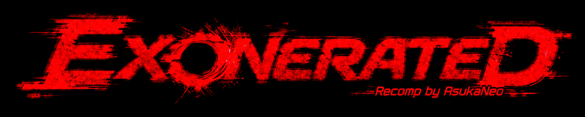
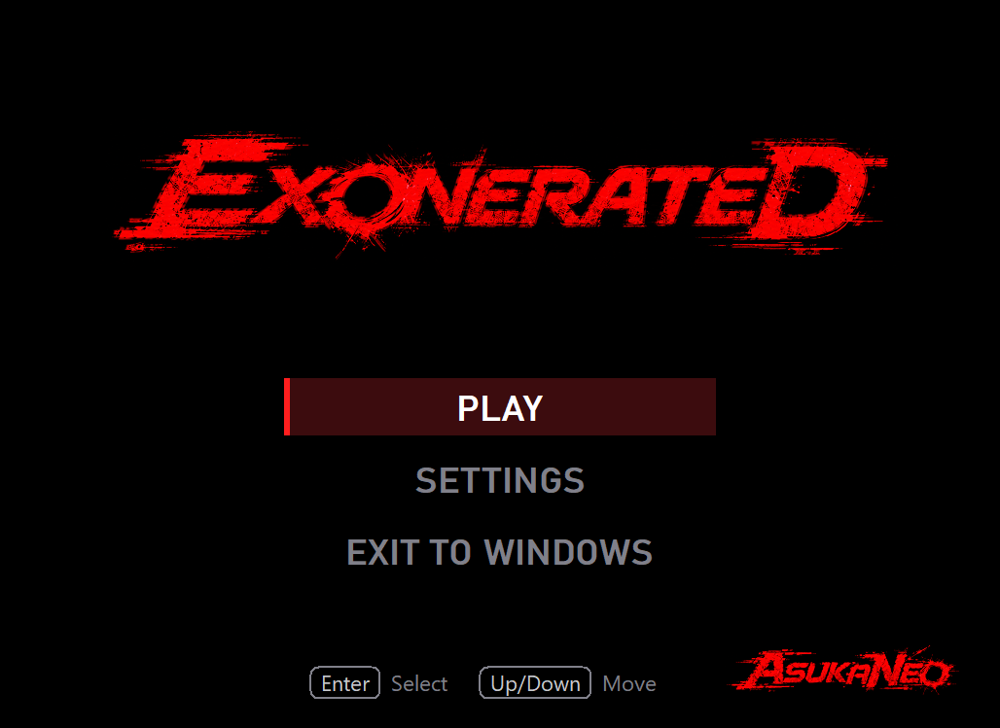
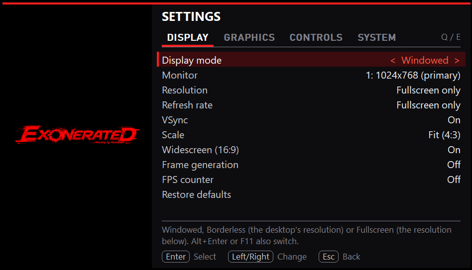
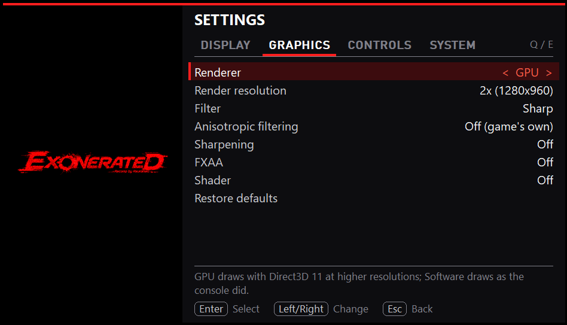

<p align="center">
  
</p>

<p align="center">
  <b><i>Deathrow</i> for the original Xbox, recompiled to run natively on Windows.</b><br>
  You bring your own copy of the game.
</p>

<p align="center">
  <a href="https://github.com/AsukaNeo/Exonerated/releases/latest"></a>
  
  
  <a href="LICENSE"></a>
</p>

<p align="center">
  <a href="https://github.com/AsukaNeo/Exonerated/releases/latest"><b>Download</b></a>
  &nbsp;·&nbsp; <a href="#getting-started">Getting started</a>
  &nbsp;·&nbsp; <a href="#settings">Settings</a>
  &nbsp;·&nbsp; <a href="#if-something-goes-wrong">Troubleshooting</a>
  &nbsp;·&nbsp; <a href="CHANGELOG.md">Changelog</a>
  &nbsp;·&nbsp; <a href="https://github.com/AsukaNeo/Exonerated/issues/new/choose">Report a bug</a>
</p>

> [!NOTE]
> Version 1.0. Full matches play from start to finish and Conquest works. A few
> small graphics glitches remain. If you hit something, please
> [open an issue](https://github.com/AsukaNeo/Exonerated/issues/new/choose).

## What is this?

*Deathrow* came out in 2002, only ever on the original Xbox, and the studio
behind it is long gone. Exonerated takes the game's own code, turns it into C
and builds it for a modern PC. No emulator involved, and you get a few modern
comforts on top.

You need your own copy of the game. All of its art, sound, levels and movies
come from your copy, and none of them are included here.

Preview - [YouTube Gameplay Video](https://www.youtube.com/watch?v=RiJnfr17ujQ)

## What you get

| | Xbox | Exonerated |
|---|---|---|
| Resolution | 640x480 | Up to 2560x1920, changed while you play |
| Picture | 4:3 | The game's own 16:9 mode, or 4:3 |
| Frame rate | 30 in matches, 60 in menus | The same game speed, plus optional frame generation for high refresh rate monitors |
| Image options | None | Anisotropic filtering, sharpening, FXAA and RetroArch shaders (CRT looks, AMD FSR) |
| Display | Your TV | Windowed, Borderless or Fullscreen, on any monitor |
| Controls | Xbox pad | Any Xbox-style controller with rumble, or the keyboard |
| Saves | The console's hard drive | A `saves` folder next to the exe, so the whole thing is portable |

## Where it's at

Working well:

- Full matches, Conquest, menus and all the movies
- Sound, controllers with rumble, and the keyboard
- Game speed that matches the Xbox
- A title card, and a settings menu laid out like a PC game's own
- The glow under the disc carrier and the lights by the goals

### Known issues

- A few textures glitch here and there, such as stripes on the backdrop of the
  loading screen before a match.
- It has only been tested on an NVIDIA GeForce RTX 5080. Reports from other
  graphics cards are very welcome.
- The exe isn't code signed, so Windows may warn about it (see
  [If something goes wrong](#if-something-goes-wrong)).
- Linux and Steam Deck through Proton or Wine are untested.
- Online play and System Link aren't possible.

Things I'd like to get to: the last graphics glitches, testing on more graphics
cards, button remapping, custom soundtracks and a Linux / Steam Deck build. Help
with any of them is welcome.

## Getting started

**What you need:**

- *Deathrow* for the original Xbox, the **North American release (version 3)**,
  either as a disc image (`.iso`) or as its files (`default.xbe` and the
  `data` folder)
- 64-bit Windows 10 or 11 and a graphics card that does Direct3D 11 (roughly
  anything from 2012 on)
- About 2 GB of free disk space: the download is about 16 MB, the copy of your
  game about 1.1 GB, and the game's own cache up to about 500 MB

Only this release works, because Exonerated is built from its exact program.
You can check your copy before downloading:

| | |
|---|---|
| Region | North America |
| Version | 3 |
| Title ID | 55530004 |
| `default.xbe` SHA-1 | `34ef43c83ffa6860019edc4fc183241107a11ed2` |

**Then:**

1. Grab the latest `Exonerated-…-windows-x64.zip` from
   [Releases](https://github.com/AsukaNeo/Exonerated/releases/latest) and unzip
   it wherever you like.
2. Run `Exonerated.exe` and point it at your disc image or `default.xbe`. It
   checks that it's the right release, then copies the game into a `game`
   folder next to the exe. That only happens the first time.
3. You'll land on the title card: Play, Settings or Exit.

<p align="center">
  
</p>

To update, unzip the new version over the old one. Your game, saves and
settings stay put.

### Where your files go

Everything stays in the folder you unzipped:

```
Exonerated.exe       the program
exonerated.ini       your settings (written on the first start)
game\                your copy of the game          keep
saves\               your saves                     keep
data\                the game's cache              safe to delete; it's rebuilt
screenshots\         F12 screenshots
shaders\             the RetroArch presets
licenses\            licences for everything included
xbox_kernel.log      the last run's log, for bug reports
```

## Controls

Any Xbox-style controller works and plays as player 1. On the keyboard, Enter
is Start, Z X C V are A B X Y, WASD moves and the arrow keys are the d-pad.

| Key | What it does |
|---|---|
| F10, or Back+Start | Settings menu |
| Alt+Enter or F11 | Windowed, or back to Borderless / Fullscreen |
| F12 | Screenshot |

The full key map is in [docs/settings.md](docs/settings.md#controller).

## Settings

Press **F10**, or **Back+Start** on the pad, at any time. The settings sit
under four tabs (Q/E, Tab or the bumpers switch them), each with a line
explaining what it does, and the mouse works too.

<p align="center">
  
</p>

### Display
- **Display mode**: Windowed, Borderless or Fullscreen. Fullscreen switches
  your monitor to the resolution you pick. Alt+Tab gives your desktop back,
  and it switches again when you return.
- **Monitor**: the monitor the game shows on, numbered as Windows numbers
  them.
- **Resolution** and **Refresh rate**: everything your monitor offers. After a
  change the game asks whether to keep it, and goes back by itself after 15
  seconds, so a resolution your monitor can't show never leaves you stuck.
- **VSync**, **Scale** (fit, integer or stretch), **Widescreen** (the game's
  own 16:9 mode), **Frame generation** and an **FPS counter**.

### Graphics

<p align="center">
  
</p>

- **Renderer**: Direct3D 11 on the GPU, or the console's way on the CPU.
- **Render resolution**: up to 4x the Xbox's (2560x1920), changed while you
  play.
- **Anisotropic filtering** up to 16x, **Sharpening** (AMD FidelityFX CAS) and
  **FXAA**, plus the filter used to scale the picture to your window.
- **Shader**: RetroArch presets over the finished picture, with three CRT looks
  and AMD FSR included (through [librashader](https://github.com/SnowflakePowered/librashader)).

### Controls
- **Rumble** and an extra **stick dead zone** for worn sticks.

### System
- **Pause in background** (off by default): the game and its sound stop while
  the window is in the background or minimised.
- **Take screenshot**, **Save settings** and **Exit to Windows**.

Each tab has **Restore defaults**. The display changes wait for "Apply display
changes", as in Windows' own display settings. Settings that only take effect
when the game starts offer a restart. Everything is saved to `exonerated.ini`;
see [docs/settings.md](docs/settings.md).

## If something goes wrong

**Windows or my antivirus warns about the exe.** The exe isn't code signed, so
SmartScreen may say it's from an unknown publisher (More info → Run anyway), and
a few antivirus tools don't like unsigned programs. Windows 11's Smart App
Control is stricter: it blocks unsigned programs outright and offers no way to
run them, so you'd have to turn it off. The checksum of each download is on its
release page, and you can always [build it yourself](#building-it-yourself).

**"Not the supported version".** Only the North American disc (version 3) works,
because Exonerated is built from that exact program.

**The picture looks wrong.** Try Renderer: Software on the Graphics tab. It's
slower and stuck at the Xbox's resolution, but it draws as the console did. Then
please tell me about your graphics card in an issue.

**It won't start, or it crashes.** Open an
[issue](https://github.com/AsukaNeo/Exonerated/issues/new/choose) and attach
`xbox_kernel.log`, which sits next to `Exonerated.exe`. Each start replaces it,
so grab it before you run the game again. Please don't attach game files.

**I want to go back to the default settings.** Use Restore defaults in the menu,
or delete `exonerated.ini`.

**Where are my saves?** In the `saves` folder next to the exe. Copy the whole
folder to another PC or drive and everything comes along.

## Building it yourself

First install these once:
[Build Tools for Visual Studio 2022](https://visualstudio.microsoft.com/downloads/#build-tools-for-visual-studio-2022)
(pick "Desktop development with C++"),
[Python 3.8 or newer](https://www.python.org/downloads/) (tick "Add python.exe
to PATH") and [Git for Windows](https://git-scm.com/download/win).

1. Download this repo (Code → Download ZIP) and unzip it.
2. Make a `game` folder inside it and put your game there.
3. Run `build.bat`. It fetches the toolkit, checks your copy of the game and
   compiles everything. The first build takes a while.
4. Run `Play Exonerated.bat`.

If `build.bat` stops, it tells you what's missing. Install that and run it
again. Everything it printed is in `build.log`.

If you want to poke at the code, start with
[docs/developers.md](docs/developers.md).

## Credits

- [xboxrecomp](https://github.com/sp00nznet/xboxrecomp) by sp00nz and
  contributors, which this whole project is built on
- [xemu](https://github.com/xemu-project/xemu), our reference for how the Xbox
  hardware behaves
- [librashader](https://github.com/SnowflakePowered/librashader) and the
  [libretro shaders](https://github.com/libretro/slang-shaders), for the Shader
  setting
- apexJCL's [xboxrecomp fork](https://github.com/apexJCL/xboxrecomp), for showing
  how to run those on Direct3D 11
- AMD's FidelityFX CAS and FSR
- A professional coder's input throughout

Licences and details for all of these are in [NOTICE](NOTICE).

## AI assistance

AI (**Claude Opus 5.5**) was used as a development assistant for the intensely time-consuming recompilation work, to make this project a reality sooner. Human-made decompilation projects are the gold standard. View the use of AI in this project in whatever way feels most appropriate to you.

## Legal

Exonerated is an unofficial, free fan project. It isn't affiliated with, endorsed
by or sponsored by Ubisoft, Southend Interactive or Microsoft. *Deathrow* and Xbox
belong to their owners and are named only to say what this works with. No logo,
box art or other artwork from the game is used; the Exonerated logo was made for
this project.

**This repo** holds no game code, data or assets: only original source, scripts
and a patch against xboxrecomp.

**The download** holds the program, which contains code translated from the
game's executable, and no textures, models, sound, music, movies, levels or disc
files. It does nothing without your own copy of the game, which it checks at
every start. Please don't ask for game files or disc images, and don't share them.

The MIT licence ([LICENSE](LICENSE), [NOTICE](NOTICE)) covers this project's own
code. The software comes as is, without warranty of any kind.
